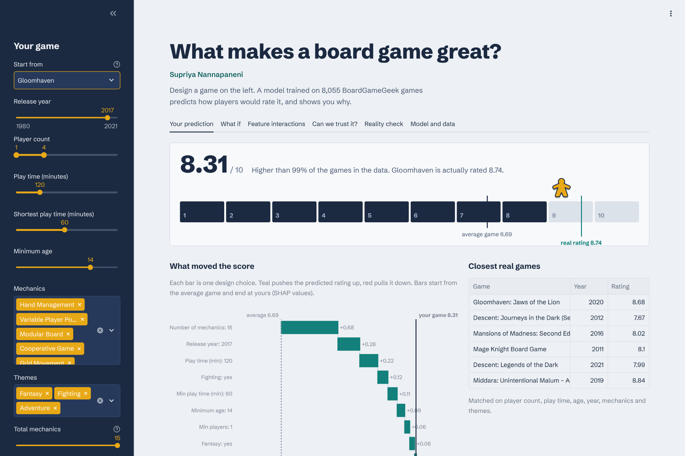
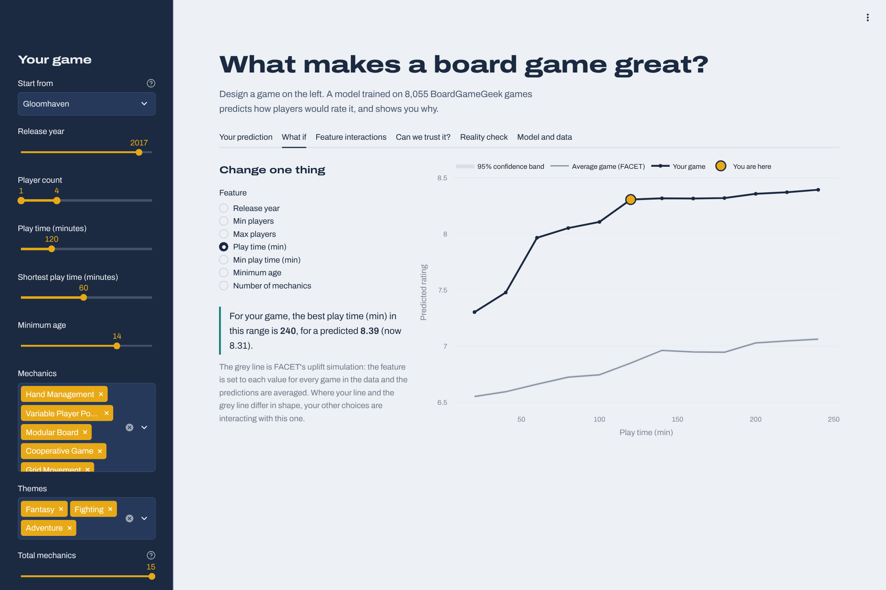
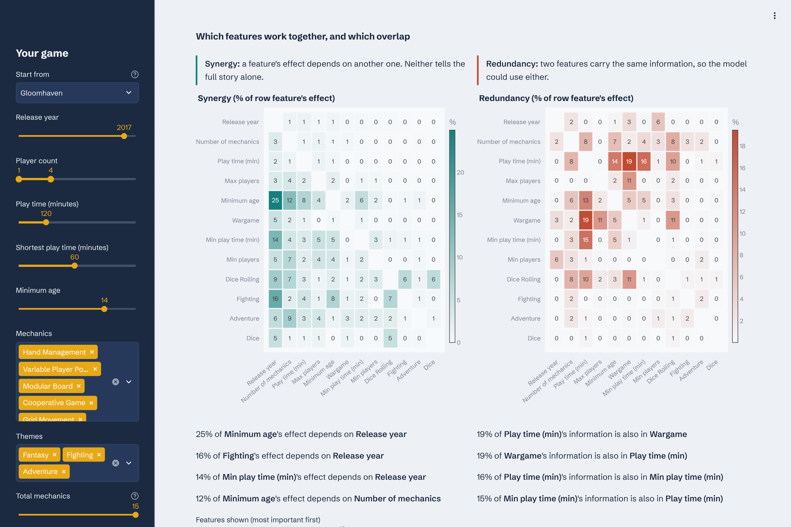
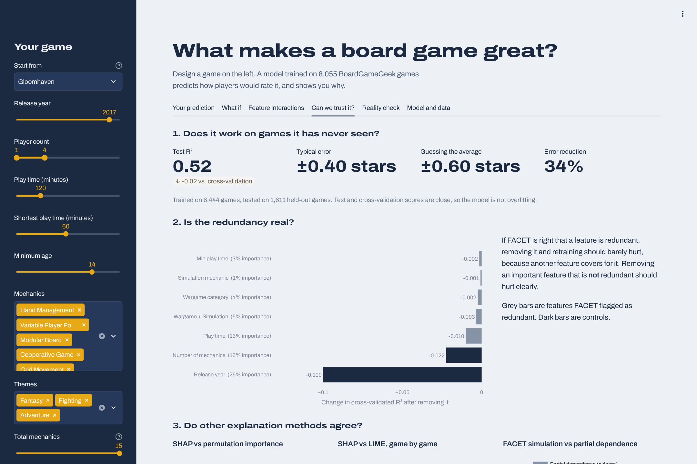
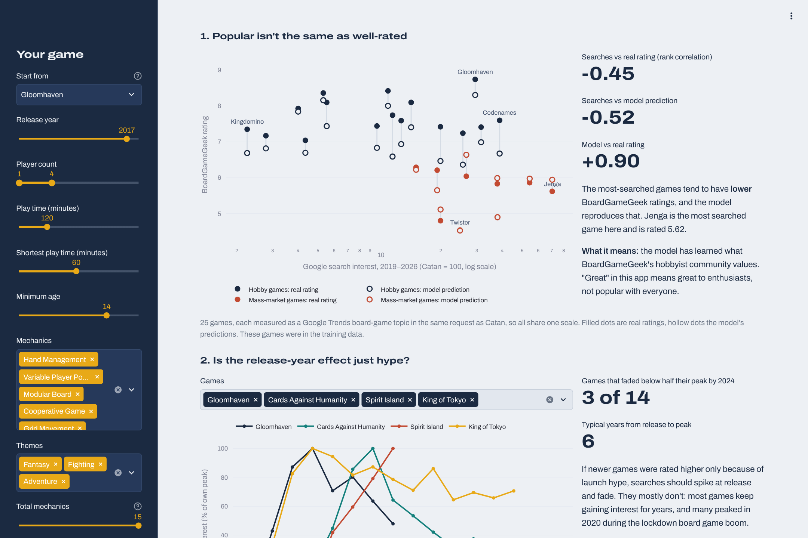

# What makes a board game great?

*By Supriya Nannapaneni*

Code: [github.com/surpiya19/tabletop-lens-xai](https://github.com/surpiya19/tabletop-lens-xai)

This is my explainable AI project for XAI (Fall '26). It's a small web app where you design
an imaginary board game, and a model trained on about 8,000 BoardGameGeek games guesses how
players would rate it. The interesting part isn't the prediction itself, it's the "why".
The app breaks down which of your choices pushed the score up or down, and then I spend a
good chunk of the project checking whether those explanations can actually be trusted.

I built most of the explanation side on [FACET](https://github.com/BCG-X-Official/facet),
an open-source library from BCG X. I picked it because it does something plain SHAP doesn't:
it tells you when two features only matter *together* (synergy) and when two features are
basically telling the model the same thing (redundancy). Board games turned out to be a
pretty good fit for that, since a lot of the features obviously overlap.

## Running it

You'll need Python 3.11 to 3.13. Grab the code, then set it up:

```bash
git clone https://github.com/surpiya19/tabletop-lens-xai.git
cd tabletop-lens-xai
python3 -m venv .venv
source .venv/bin/activate
python -m pip install -r requirements.txt
python -m streamlit run app.py
```

It should open in your browser. Everything heavy is already computed and saved in
`artifacts/`, so the app starts right away. Remember to run `source .venv/bin/activate` again
whenever you open a new terminal (I kept forgetting this).

The quickest way to get a feel for it is the **Start from** menu in the sidebar. Pick a real
game like Gloomhaven or Pandemic, see what the model thinks, then start changing things.

## A quick tour

There are six tabs. Here's what the main ones look like, using Gloomhaven as the example.

### Your prediction



The score track at the top shows the prediction, and the meeple marks where your game lands.
For Gloomhaven the model predicts 8.31, and its real rating is 8.74, so it's close but a little
low. The waterfall underneath shows why: having 15 mechanics adds the most (+0.68), followed
by the 2017 release (+0.26) and the two-hour play time (+0.22). On the right are the real games
most similar to what you designed.

### What if



Here I'm varying play time for Gloomhaven. Below an hour its predicted rating drops quickly
(down to about 7.3 at 20 minutes), but after two hours it barely changes. The grey line is
FACET's simulation for the average game, which climbs more steadily. When the two lines have
different shapes, that's the other features interacting with the one you're changing.

### Feature interactions



These are FACET's synergy and redundancy matrices. The strongest synergy is minimum age with
release year (25% of minimum age's effect depends on the year). For redundancy, play time
overlaps a lot with the Wargame category (19%) and with the shortest play time (16%).

### Can we trust it?



This is where I test the explanations (details further down). The bar chart is the one I like
most: removing features FACET called redundant barely changes accuracy, but removing release
year costs 0.10 R².

### Reality check



Each game's Google search popularity against its rating. Filled dots are the real ratings and
hollow dots are the model's predictions. The red mass-market games like Jenga get searched way
more but are rated much lower, and the model follows that pattern too.

The last tab, **Model and data**, has the model comparison, overall feature importance and the
limitations.

## What I found

The model mostly cares about three things: **release year** (about 25% of the importance),
**how many mechanics a game has** (16%), and **play time** (13%). Basically, BoardGameGeek
users like newer, longer, more complex games.

The redundancy analysis was the part I was most curious about. FACET grouped *Wargame*, the
*Simulation* mechanic and *play time* together, which makes sense when you think about it,
since they all describe long, heavy strategy games.

## Checking the explanations

I didn't want to just show nice charts and call it a day, so I tried to test the
explanations in a few different ways:

1. **Does it work on games it hasn't seen?** On 1,611 held-out games the R² is 0.52, close
   to the 0.54 I got in cross-validation, so it isn't overfitting. It's off by about ±0.40
   rating points on average, which is 34% better than just guessing the average rating.
2. **Is the redundancy real?** If FACET says a feature is redundant, removing it should
   barely matter. That's what happened: dropping play time (13% importance) only cost 0.010
   R², while dropping release year cost 0.10.
3. **Do other methods agree?** SHAP and permutation importance picked the same top 5
   features. SHAP and LIME agreed on direction 94% of the time. And FACET's simulation turned
   out to be identical to a partial dependence plot, which I didn't expect going in.
4. **Is it stable?** I retrained on five different random 80% splits, and the importance
   ranking barely moved (average rank correlation 0.96).

`validate.py` runs all of these.

## The Google Trends part

This was a late addition. I wanted some outside data the model had never seen, so I pulled
Google search interest for 25 of the games. Two things came out of it:

- **Popular is not the same as well-rated.** The more a game gets searched, the *lower* its
  BGG rating tends to be (rank correlation −0.45). Jenga is the most searched game in my set
  and it's rated 5.62. The model shows the same pattern, so what it has really learned is
  what BGG hobbyists like, not what's popular with everyone.
- **It proved one of my own explanations wrong.** I originally assumed newer games score
  higher because of launch hype. But if that were true, searches should spike at release and
  then fade, and they mostly don't: only 3 of 14 games dropped below half their peak by 2024.
  So I honestly don't know yet why release year matters so much.

Google Trends doesn't have a public API anymore (pytrends got archived), so I collected the
data with a script run in the browser on trends.google.com. It's in `trends/`, along with
notes on the weird bits I ran into, like the Pandemic game picking up COVID searches in 2020.

## Re-running everything

You don't need to do this to use the app, but if you want to reproduce the results
(takes around 10 minutes):

```bash
python -m pip install -r requirements-analysis.txt
python prepare_data.py    # downloads the BGG data and builds the features
python analyze.py         # FACET model selection, inspection and simulation
python validate.py        # the four trust checks
python make_figures.py    # figures for the report and poster
```

## How the folder is organised

```
app.py                  the Streamlit app
prepare_data.py         data cleaning and feature building
analyze.py              FACET: model selection, synergy/redundancy, simulation
validate.py             the validation checks
make_figures.py         static figures (300 dpi, in figures/)
screenshots/            the app screenshots used in this README
data/                   cleaned BGG data and the Google Trends data
artifacts/              saved model and results the app loads
trends/                 the script I used to collect the Google Trends data
```

## Limitations

There are a few things worth keeping in mind:

- **This is correlation, not causation.** Publishing your game in 2021 won't make it better.
- **A lot is missing.** Art, publisher, marketing and rules complexity aren't in the data,
  and about half the variation in ratings is unexplained.
- **The data is biased toward successful games.** I only kept games with 200+ ratings, so
  the model has barely seen games that flopped.
- **Weird designs get weird predictions.** A 12-player, 8-hour party game is unlike anything
  it was trained on.
- **The explanations explain the model, not the world.** If the model picked up a bias, the
  explanations will faithfully show you that bias.

## Credits

- Data: [TidyTuesday, 25 Jan 2022](https://github.com/rfordatascience/tidytuesday/tree/master/data/2022/2022-01-25),
  scraped from BoardGameGeek
- Explanations: [FACET](https://github.com/BCG-X-Official/facet) by BCG X, SHAP and LIME
- Model: LightGBM
- App: Streamlit, with the Schibsted Grotesk font (SIL Open Font License)
- Search data: Google Trends
